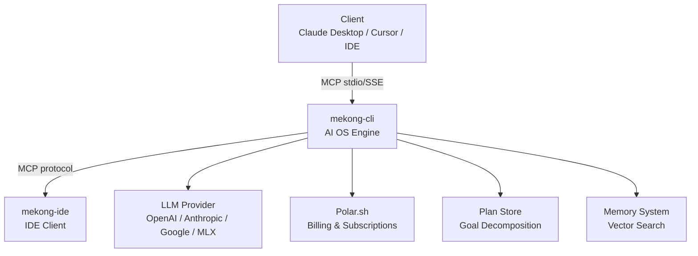

MekongMind consists of two main components that work together to provide AI agent orchestration.

## High-Level Architecture

## mekong-cli (AI OS Engine)

The core engine is a Python MCP server that exposes 25+ tools. It handles:

- **Tool Execution** — all MCP tools run in-process
- **LLM Routing** — provider selection, fallback, streaming
- **Persistence** — plan store, memory, task state as JSON
- **Billing** — usage metering, Polar webhook handling

## mekong-ide (IDE Client)

A TypeScript IDE client (OpenCode fork) with:

- **Typed MCP Client** — invoke all 25 tools with full type safety
- **StdioClientTransport** — clean process lifecycle, no zombie processes
- **Integration Tests** — 7 tests, all passing
- **Zero TypeScript Errors** — strict mode

## MCP Protocol

Both engines communicate via the [Model Context Protocol](https://modelcontextprotocol.io):

- **stdio** — direct subprocess communication
- **SSE** — Server-Sent Events for remote connections
