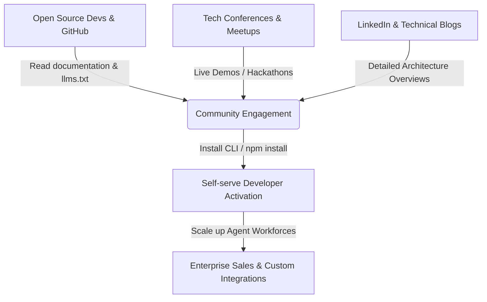

# MekongMind Marketing Strategy

> **MekongMind** — The Unified AI Operating System for Autonomous Business Operations.
> Target Audience: Developers, B2B SaaS Founders, Enterprise Teams, Systems Integrators.
> Location: Global & Vietnam.

---

## 1. Executive Summary
MekongMind is a next-generation, 6-layer AI Operating System (CheetahClaws) designed to orchestrate complex multi-agent workflows across Business, Product, Engineering, Ops, and Strategy. Operating under the Water Protocol (水), it solves the context-loss problem in agentic workflows by providing a seamless, multi-agent context flow. 

This strategy focuses on capturing developer mindshare, onboarding SaaS builders, and establishing MekongMind as the go-to open standard for multi-agent execution.

---

## 2. Market Analysis & Target Personas

### Target Segments
1. **AI Engineers & Builders**: Developers building multi-agent apps who need stable runtime environments, state persistence, and native MCP orchestration.
2. **SaaS Founders & Tech Startups**: Small teams looking to automate customer success, lead nurturing, and billing reconciliation using agent workforces.
3. **Enterprise CTOs / VP of Engineering**: Decision-makers seeking unified standards for security, LLM provider abstraction, and compliance in agent orchestration.

### Competitive Positioning
* **Competitors**: CrewAI, LangGraph, AutoGen, Microsoft Semantic Kernel.
* **MekongMind Edge**:
  * Unified 6-layer architecture (Studio → Founder → Business → Product → Engineering → Ops).
  * The Water Protocol (水) context flow, preventing conversational drift.
  * CheetahClaws MCP Server providing 25+ production-ready tools natively.
  * Vendor-agnostic LLM orchestration (OpenAI, Gemini, DeepSeek, Anthropic) via unified environment vars.

---

## 3. Brand Positioning & Key Messages
* **Core Value Proposition**: *"Run your entire business as a network of coordinated, self-correcting AI agents."*
* **Primary Taglines**:
  * "Code less, orchestrate more. MekongMind is the runtime for the agentic era."
  * "Water Protocol (水): Uninterrupted context flow for multi-agent networks."
* **Voice and Tone**: Technical, authoritative, developer-centric, execution-focused, and highly practical.

---

## 4. Acquisition Channels & Growth Engine

### Channel Details
1. **Developer Relations & Technical Content (PLG)**:
   * Publishing deep dives on the Water Protocol (水) and multi-agent context synchronization on Hacker News, Dev.to, and Medium.
   * Curating a clean `llms.txt` and developer portals to optimize for AI search engines (Perplexity, ChatGPT, Gemini).
2. **GitHub Growth & Open Source SEO**:
   * Optimizing the README and repository tags for keywords like "multi-agent orchestration", "MCP server", "CheetahClaws", and "AI agent framework".
3. **Community & Events**:
   * Hosting monthly developer hackathons with prizes for building the best custom MCP tool or agent adapter.

---

## 5. Pricing & Monetization Model
MekongMind will offer a three-tier model:
* **Core OS (Open Source - BSL 1.1)**: Free self-hosted CLI, memory storage, standard adapters.
* **Mekong Cloud (Developer Tier)**: Managed CheetahClaws servers, real-time debugging dashboards, hosted vector databases, and billing/payment integrations (Stripe, Polar, Creem) ready out of the box.
* **Enterprise Custom OS**: SSO, private LLM gateway, custom-designed compliance layers, dedicated support channels, and SLA-backed multi-agent performance monitors.
